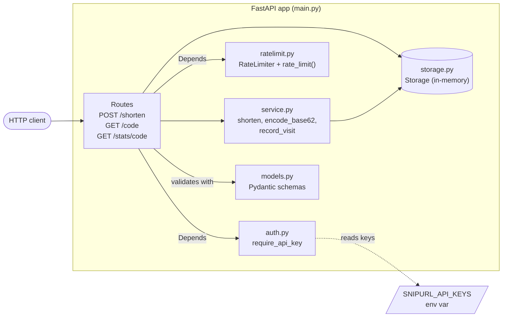
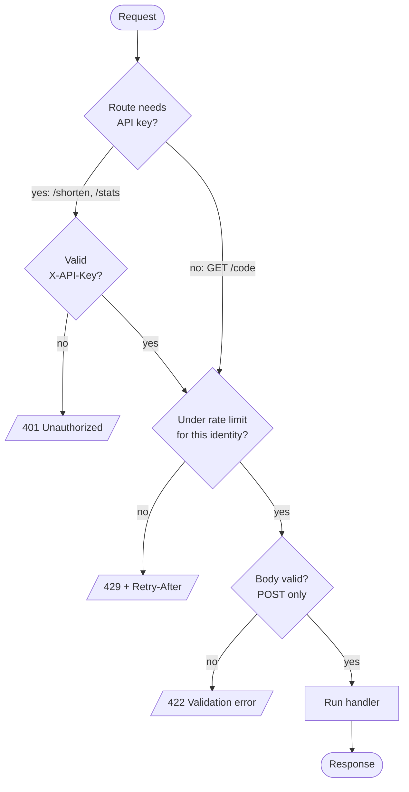
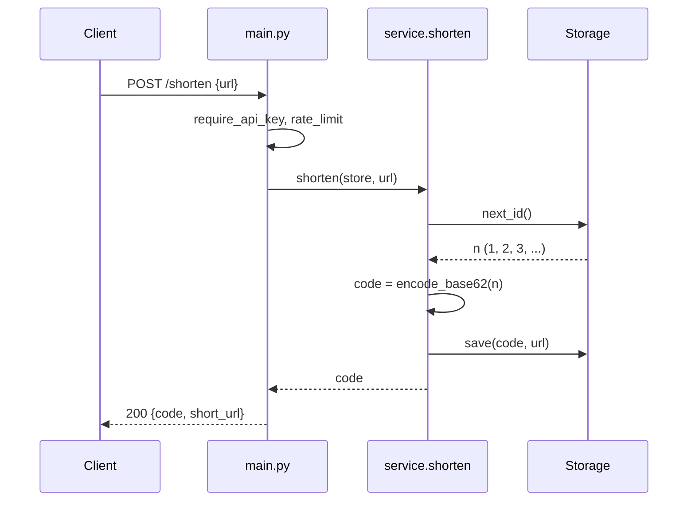
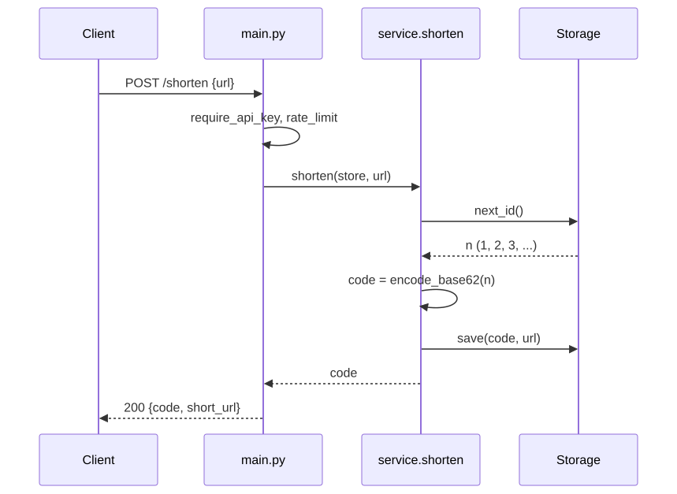
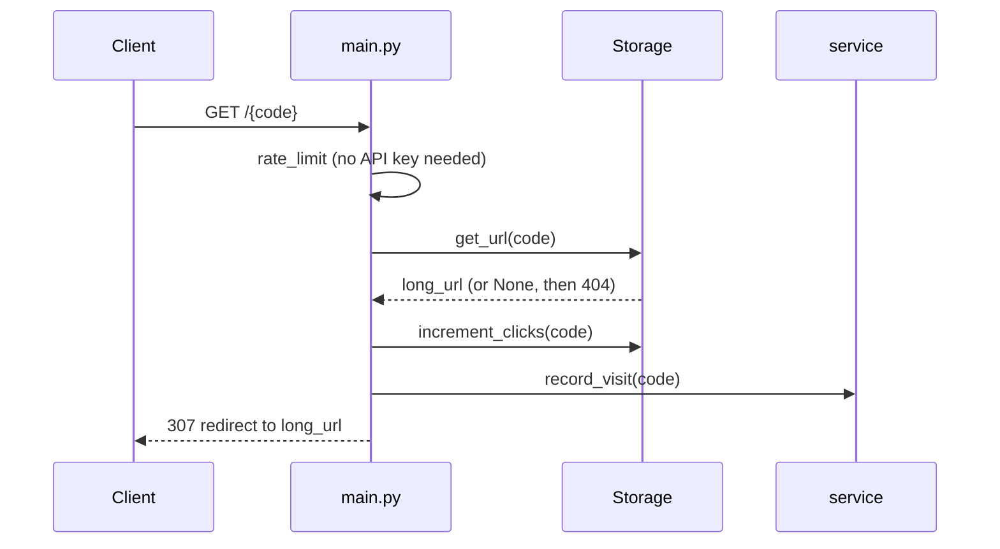
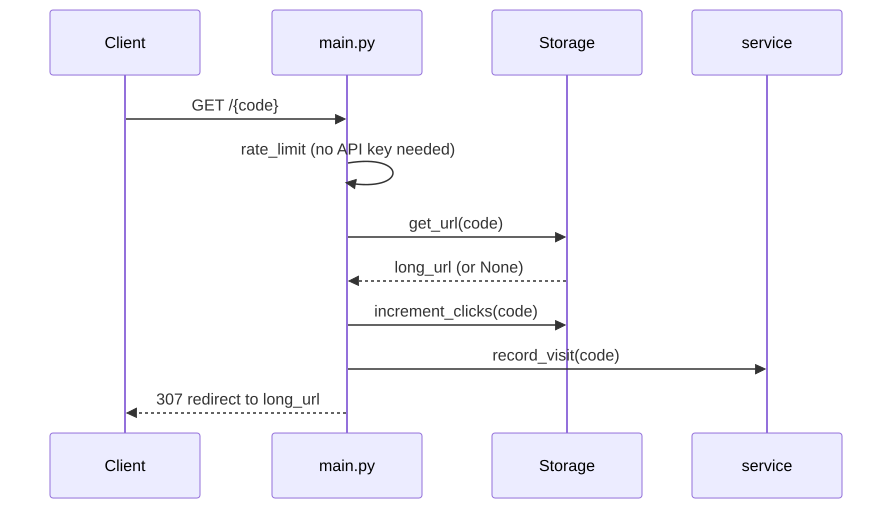

# SnipURL Architecture

> Each diagram is Mermaid source followed by a pre-rendered SVG in `docs/diagrams/`,
> so it is visible even in viewers that don't render Mermaid. Regenerate the SVGs
> if you change the diagrams.

SnipURL is a small URL shortener built with FastAPI. A single process holds
all state in memory.

## Component overview

| Module | Responsibility |
|---|---|
| `main.py` | Creates the app and one shared `Storage`; declares routes and wires auth and rate-limit dependencies. |
| `models.py` | Request and response schemas (`ShortenRequest`, `ShortenResponse`, `StatsResponse`). |
| `service.py` | Business logic: ID to base-62 code, saving a URL, visit log. |
| `storage.py` | In-memory maps for URLs and click counts, plus the ID counter. |
| `auth.py` | `X-API-Key` header check against `SNIPURL_API_KEYS` (default `dev-key`). |
| `ratelimit.py` | In-memory sliding-window limiter, keyed per API key or client IP. |

## Request pipeline

Dependencies on a route run in the order listed, so authentication happens
before rate limiting. A request with a bad key is rejected with 401 and never
counts against a limit.

## Flow: shorten a URL

## Flow: follow a short link

## Design notes and limits

- **Single process only.** Storage and rate-limit counters live in process
  memory. Running more than one instance gives each its own codes, clicks and
  limits. The code comments suggest Redis or Postgres for production.
- **Restart loses everything.** Nothing is persisted.
- **Rate-limit identity.** Calls with an `X-API-Key` header are limited per key;
  others per client IP (`request.client.host`).
- **Short URL host** comes from `SNIPURL_BASE_URL` (default `http://snip.url`).

## Known issues

All previously listed bugs are fixed: click counting, unknown codes (now 404),
`encode_base62(0)`, the unbounded visit log, URL validation (http/https only),
and the rate-limit bypass with fake keys. Remaining limits are the design
notes above (single process, no persistence, sequential guessable codes).
