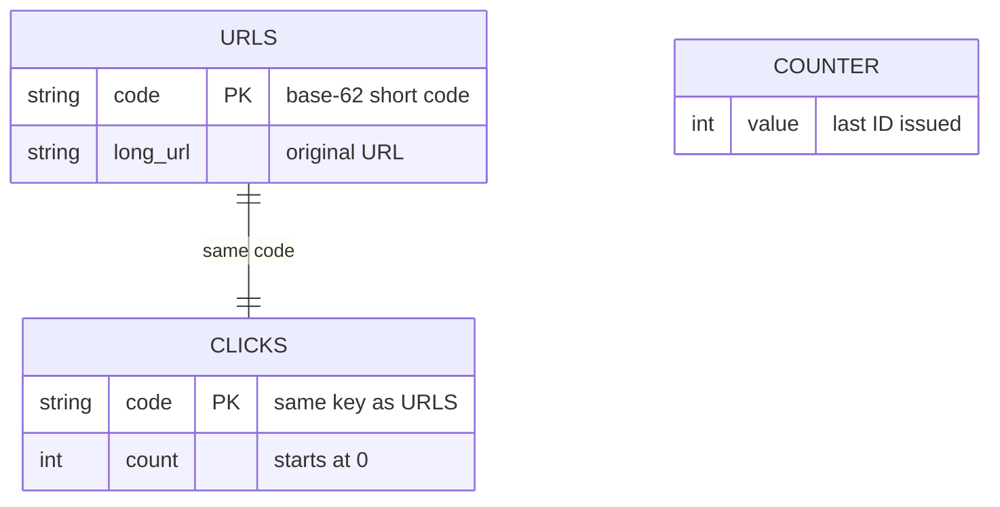
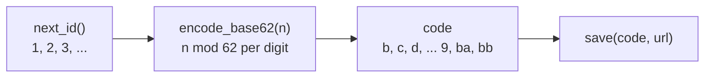

# SnipURL Storage

All persistent-looking state lives in `storage.py` in a single `Storage`
object, created once in `main.py` (`store = Storage()`). It is in-memory only.

## Data model

| Attribute | Type | Purpose |
|---|---|---|
| `_urls` | `dict[str, str]` | code to long URL |
| `_clicks` | `dict[str, int]` | code to click count |
| `_counter` | `int` | last ID issued; starts at 0 |

## Methods

| Method | Behavior |
|---|---|
| `next_id()` | Increments `_counter` and returns it. First call returns `1`. |
| `save(code, long_url)` | Writes `_urls[code]` and resets `_clicks[code]` to `0`. Overwrites an existing code. |
| `get_url(code)` | Returns the long URL, or `None` if the code is unknown. |
| `increment_clicks(code)` | Adds 1 to the count; returns 0 for unknown codes. |
| `get_clicks(code)` | Returns the count, or `0` for an unknown code. |

## How codes are generated

`service.shorten` asks storage for the next ID and encodes it in base 62
using the alphabet `a-z`, `A-Z`, `0-9` (lowercase first).

Because the alphabet starts at `a` (index 0) and IDs start at 1, the first
code is `b`, not `a`. Codes are sequential and therefore guessable.

## Fixed bugs

- `increment_clicks` now stores the new count and returns 0 for unknown codes
  without creating an entry.
- `next_id` is guarded by a `threading.Lock`.
- `service.encode_base62(0)` returns `a`; `record_visit` uses a bounded deque.
- Routes return 404 for unknown codes before counting a click.

## Limitations

- **Volatile:** all data is lost when the process restarts.
- **Single instance:** each process has its own maps and counter, so scaling
  out would produce duplicate codes and split click counts.
- **No expiry or deletion:** entries live until restart.
- **No URL uniqueness:** shortening the same URL twice yields two codes.

## Moving to a real database

The class is the only storage seam, so a replacement needs to keep the same
five methods. A reasonable mapping:

| Method | Redis | Postgres |
|---|---|---|
| `next_id` | `INCR snipurl:id` | `nextval` on a sequence |
| `save` | `HSET`/`SET` code to URL | `INSERT` into `urls(code, long_url, clicks)` |
| `get_url` | `GET` | `SELECT long_url` |
| `increment_clicks` | `INCR clicks:{code}` | `UPDATE ... SET clicks = clicks + 1` |
| `get_clicks` | `GET` | `SELECT clicks` |

Both give atomic ID and click increments, which also fixes the thread-safety
and multi-instance issues. The rate limiter in `ratelimit.py` has the same
in-memory limitation and would need a shared backend at the same time.
